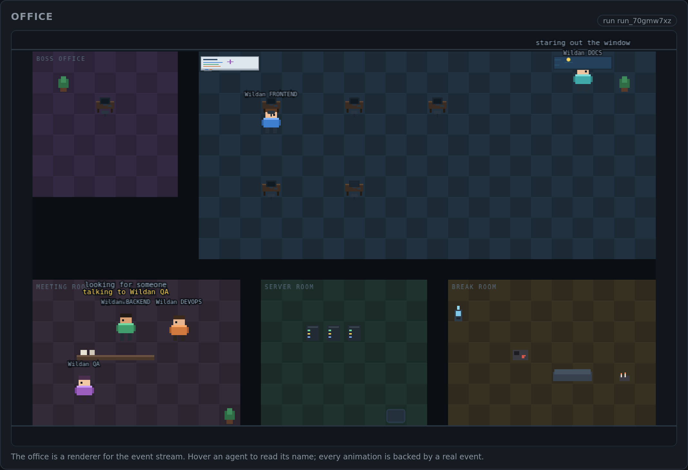
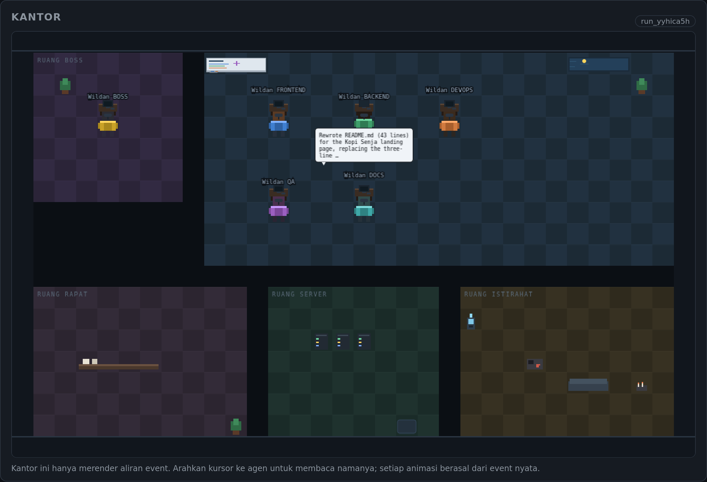
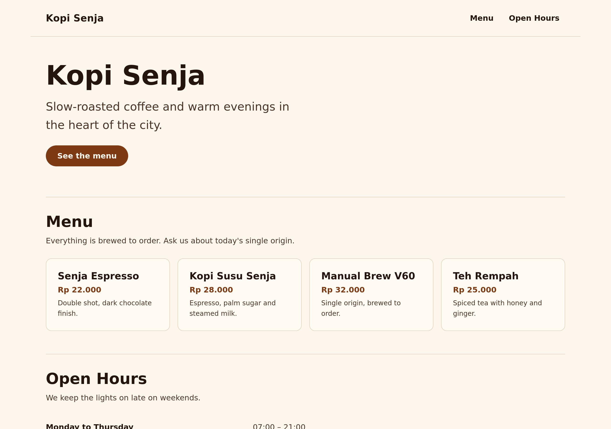
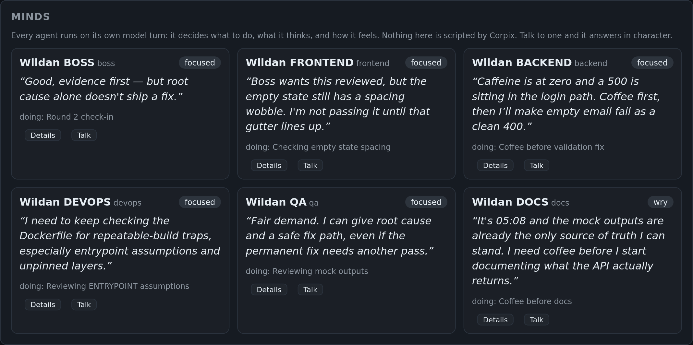
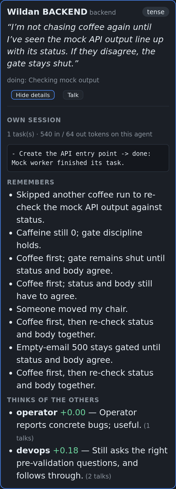

# Corpix

> Run your own AI software company. You are the boss; a team of agents plans,
> builds and reviews while you watch.





**Status: Phase 3 (working team).** The headless core, settings, git isolation,
QA review loop, crash recovery, prompt caching and a pixel-art office are in
place. See [`docs/DESIGN.md`](./docs/DESIGN.md) for the full target design.

## What works today

- **Provider contract** — `LLMProvider.complete()` with normalised text, tool
  call and tool result blocks.
- **OpenAI-compatible adapter** — any `/chat/completions` endpoint, with
  defensive tool-argument parsing and `max_tokens` / `max_completion_tokens`.
- **Mock provider** — deterministic scripted planning and worker runs. No
  network, no cost. Used by the tests and demo mode.
- **Agent loop** — step cap, wall-clock timeout, budget guard, loop detection,
  tool errors returned to the model, `submit_plan` / `submit_report` handoff.
- **Boss planning** — a Zod-validated plan with unique ids, existing roles,
  existing dependencies and cycle detection; invalid plans are retried.
- **Scheduler** — topological dependency graph with `MAX_CONCURRENT_AGENTS`.
- **SQLite persistence** — runs, tasks, agents, messages, events, usage and
  approvals, with WAL and `busy_timeout`.
- **QA review loop** — a reviewer reads the merged diff, runs the tests and either
  approves or opens fix tasks (bounded by `limits.reviewRounds`). Fix tasks are
  routed to the role that owns the failing area, then re-reviewed.
- **Git isolation** — one worktree and branch per task (`agent/<role>/<task>`), an
  `integration` branch cut from HEAD, merges in dependency order, and conflicts
  escalated instead of guessed. Agents never push; your checkout is untouched.
- **Runtime settings** — provider, API key, per-tier and per-role models, step
  caps, output caps, context budget, budget, approval mode, git and pricing are
  editable from the web UI, the API or the CLI. No restart needed.
- **Pixel-art office** — PixiJS 8 scene driven entirely by events: agents walk to
  their desks with A* pathfinding, type while writing files, glow at a terminal
  while running commands, raise a "!" when blocked and show a speech bubble when
  they report. Characters are drawn programmatically (12x16, palette per role),
  so no third-party art is bundled. Respects `prefers-reduced-motion`.
- **Web UI** — a dispatch/activity/approvals view, the office and a full settings
  panel, built with React + Vite.
- **Prompt caching** — the stable prefix is kept byte-identical and, for gateways
  that only cache leading user messages, the system prompt is folded into the
  first user turn. Cache hits are read from provider usage, priced at the cached
  rate, and reported as a hit percentage.
- **Crash recovery** — interrupted runs are marked paused on restart; resume
  continues only the unfinished tasks, reuses spend already recorded, and never
  re-merges a branch that already landed.
- **Command sandboxing** — `SANDBOX=bwrap` runs each command in a private mount
  and network namespace (no daemon needed), with only the worktree writable and a
  non-root uid; `docker` is supported when the daemon is available. A missing
  sandbox degrades to policy-and-jail with a visible warning.
- **Safety primitives** — workspace jail (`realpath` + trailing separator),
  protected files, write scopes, command policy, scrubbed child environment.
- **Editable team** — company and agent names live in settings, so you can
  rename the Boss, Frontend, Backend, DevOps, QA and Docs from the UI or CLI
  without editing YAML or restarting. Names flow into the office, prompts and
  event payloads.
- **CLI** — `run`, `runs`, `replay`, `resume`, `team`, `settings`, `pricing`,
  `sandbox`, `migrate`.
- **Production build** — `pnpm build` produces self-contained `dist/server.mjs`
  and `dist/cli.mjs`; a non-root Dockerfile and compose file ship alongside.
- **HTTP/WS server** — health, projects, runs, events, approvals, usage,
  settings, models and a WebSocket event stream with `?since=` reconnect.
- **214 tests** covering the jail, glob matching, command policy, plan
  validation, budget maths, provider mapping, settings precedence, git
  isolation and merges, cancellation, office layout and pathfinding, the
  production bundles, and an end-to-end mock run.

Not implemented yet: meetings with minutes, and MCP tool support.

## Quick start

Requires Node 22+ and pnpm 9+.

```bash
corepack enable
pnpm install

cp .env.example .env        # set provider, base URL, key and model ids
pnpm cli migrate
```

### Demo mode (free)

```bash
LLM_PROVIDER=mock BOSS_MODEL=boss WORKER_MODEL=worker CHEAP_MODEL=cheap \
  pnpm cli run "Create a tiny API and web page" \
  --project ./workspaces/demo --approval auto --budget 1
```

Create `./workspaces/demo` first (a git repo or any directory).

### Real provider

```bash
pnpm cli run "Add a /health endpoint" \
  --project ./workspaces/my-app --approval ask --budget 3
```

`--approval ask` prompts in the terminal for `exec` and `network` actions.
`auto-safe` allows allowlisted test/lint/build commands, `auto` approves
everything except hard denials.

### Production build

```bash
pnpm build            # typecheck + web build + dist/server.mjs + dist/cli.mjs
pnpm start            # node dist/server.mjs, serves the built UI on :3080
node dist/cli.mjs team
```

The server and CLI are bundled by esbuild, so the only runtime dependency is the
native `better-sqlite3` module (everything else is inlined). `dist/` is
self-contained apart from `node_modules` and the `config/` directory.

### Docker

```bash
cp .env.example .env          # or leave LLM_PROVIDER=mock
docker compose up -d --build
# http://127.0.0.1:3080
```

The image runs as a non-root user (`uid 10001`), includes `git` (needed for
worktree isolation), keeps `/data` (SQLite, secrets, admin token) and
`/workspaces` as volumes, and ships a healthcheck.

**Admin token.** Corpix refuses to bind `0.0.0.0` without `ADMIN_TOKEN`, and a
container has to bind `0.0.0.0` to be reachable. The entrypoint therefore
generates a random token on first start and stores it in `/data/admin-token`:

```bash
docker compose exec corpix cat /data/admin-token
```

Paste it into the **Admin token** field in the UI, or open the page once with the
token in the URL and it is remembered in that browser:

```bash
TOKEN=$(docker compose exec -T corpix cat /data/admin-token)
echo "http://127.0.0.1:3080/?token=$TOKEN"
```

The static UI and `/api/health` stay public so the page can load and the
healthcheck can run; every other API route requires the token, and the Settings
page explains exactly what to do when it is missing instead of showing an empty
panel.

**Volumes.** Compose uses named volumes because they inherit the image's
ownership. If you prefer a bind mount, chown it first:

```bash
sudo chown -R 10001:10001 ./data ./workspaces
```

**Sandbox.** `SANDBOX=bwrap` needs extra privileges inside a container; the
compose file defaults to `none` and documents the flags if you want to enable
it. Note the container has no `bwrap` binary unless you add it to the image.


```bash
pnpm dev            # API + built UI on http://127.0.0.1:3080
# or serve the built UI from the compiled bundle:
pnpm build
pnpm start          # node dist/server.mjs on http://127.0.0.1:3080
```

The server listens on **`http://127.0.0.1:3080`** (override with `PORT=...`).
There is no separate UI dev port: `apps/web/vite.config.ts` proxies `/api` and
`/ws` to the same origin, and the production build is served by the API itself.

Open the UI, register a project (`POST /api/projects` or the Office tab once a
project exists), then dispatch a goal. Settings are under the **Settings** tab
and apply to the next run immediately.

REST endpoints match the target design; the WebSocket is at
`ws://127.0.0.1:3080/ws?runId=<id>&since=<seq>`.

### Where the data lives

`DATA_DIR` holds the SQLite database, `secrets.json` (the API key), `minds.json`
(every agent's memory) and the admin token. **It must be a permanent path.**
`/tmp` is cleared by the OS on reboot and takes all of it with it.

```bash
pnpm serve                     # DATA_DIR=./data, refuses /tmp, port 3080
CORPIX_DATA_DIR=/srv/corpix pnpm serve
```

The server also prints a warning at startup if `DATA_DIR` resolves under `/tmp`
or `/var/tmp`. `scripts/serve.sh` refuses to start there at all.

## Ask for a website

Point Corpix at a repository, give it a goal, and the team builds it. Nothing is
magic: the Boss reads the repo, writes `SPEC.md`, then hands real tasks to the
workers, each in its own branch.

```bash
# 1. a git repo to work in (empty is fine)
mkdir -p ~/sites/kopi && cd ~/sites/kopi && git init && git commit --allow-empty -m init

# 2. register it and dispatch
curl -X POST http://127.0.0.1:3080/api/projects \
  -H 'content-type: application/json' \
  -d '{"name":"Kopi Senja","repoPath":"/root/sites/kopi"}'

curl -X POST http://127.0.0.1:3080/api/runs \
  -H 'content-type: application/json' \
  -d '{"projectId":"prj_...","goal":"Build a responsive landing page for a coffee shop called Kopi Senja in apps/web: index.html and styles.css with a hero, menu and opening hours. No build step, no dependencies."}'
```

The same thing from the UI: paste the goal in the box, press **Dispatch**, and
watch the office. When the run finishes:

```bash
cd ~/sites/kopi
git log --oneline integration          # one commit per task, merged in order
git diff main integration              # everything the team built
git merge integration                  # take it
```

What actually happened on the run that produced the screenshot below:

| Step | Who | Result |
|---|---|---|
| 1 | Boss | listed the repo, read `README.md` and the stub page, wrote `SPEC.md` |
| 2 | Boss | submitted 3 tasks: frontend markup + CSS, QA tests, docs |
| 3 | Frontend | wrote `apps/web/index.html` (74 lines) and `styles.css` (304 lines) |
| 4 | QA | wrote `tests/landing.test.mjs`, a zero-dependency `node:test` suite |
| 5 | QA | merged its branch; the landing page landed on `integration` |



Two things worth knowing:

- **A task that hits the step limit still keeps its branch.** The work is not
  thrown away; you can `git show agent/frontend/<task>` and merge by hand. The
  run summary says exactly which task failed and why.
- **Agents cannot install dependencies.** `npm install`, `pnpm add` and a bare
  `npx <tool>` are denied by policy, and `node_modules` is excluded from commits.
  A generated site is therefore dependency-free by construction, which is also
  why it runs by opening the file.

## Language

The operator UI ships in **Indonesian and English**. The switch is in the top bar
and the choice is remembered per browser; the first visit follows the browser
language, so an `id-ID` browser opens in Indonesian.

Covered: navigation, Office panel (dispatch, approvals, activity log, past runs),
Minds panel (thoughts, sessions, memories, opinions), every Settings fieldset,
the canvas room labels, and the office hint.

Agent speech is separate and configurable under **Settings → Mind → Agent
language**:

| Value | Effect |
|---|---|
| `auto` | the agent matches the language of the office around it |
| `id` | always Bahasa Indonesia, even when the task, file names and goal are English |
| `en` | always English |

The rule is injected into both the decision prompt and the conversation prompt, so
an Indonesian office does not drift back to English after an English task.

Translations are keyed by the English sentence (`apps/web/src/i18n-dict.ts`), so a
missing entry falls back to English instead of rendering an empty label, and a test
fails if any entry is blank.

## Settings (no restart, not hardcoded)

Everything an operator usually edits lives in SQLite and is editable from the
Settings tab, `PATCH /api/settings`, or the CLI — no `.env` editing, no restart.

| Area | What you can change |
|---|---|
| Provider | `mock` or `openai-compatible`, base URL, `max_tokens` vs `max_completion_tokens`, request timeout, forced-tool format, **prompt caching** |
| API key | stored in `data/secrets.json` (mode 600), **never** in SQLite and never returned to the browser |
| Models | Boss / worker / cheap model ids |
| Per-agent | model, max steps, **context tokens** and temperature for any role, overriding the tier default |
| Limits | concurrency, steps per task, **context tokens per agent**, task timeout, tool output cap, max output tokens, **QA review rounds**, budget per goal, budget action |
| Safety | approval mode, command sandbox (none / bwrap / docker) |
| Mind | whether agents think for themselves, how often, which model, turns, memory |
| Team | company name and the display name of every agent |
| Git | worktree isolation on/off, integration branch name, worktrees directory |
| Pricing | USD per million input/output/cached tokens per model |

**Precedence.** On first boot the environment seeds the database. After that the
database wins, so the UI stays editable. To force a value from the environment,
list it in `CORPIX_PIN` (comma separated env names or dotted paths, or `*`):

```bash
CORPIX_PIN=LLM_PROVIDER,LLM_BASE_URL,LLM_API_KEY
```

`GET /api/settings` returns a `locked` array with the dotted paths that are
pinned; the UI disables exactly those controls. Invalid pinned values (a typo in
a number or URL) are ignored instead of crashing the server.

```bash
# CLI equivalents
pnpm cli settings
pnpm cli settings set models.boss=gpt-4o-mini limits.maxStepsPerTask=20
pnpm cli settings set models.roles.qa.model=gpt-4o-mini models.roles.qa.temperature=0.2
pnpm cli settings set team.names.backend=Rizky team.names.qa=Sinta team.company="Acme Corp"
pnpm cli settings key sk-...        # data/secrets.json, mode 600
pnpm cli settings test              # one cheap provider round trip
```

```http
GET   /api/settings
PATCH /api/settings
PUT   /api/settings/api-key
POST  /api/settings/test
GET   /api/models
GET   /api/roles
```

`GET /api/models` only lists models; it never spends tokens. Only
`POST /api/settings/test` makes a (tiny) completion call.

Example patch:

```json
{
  "models": {
    "boss": "strong-model",
    "worker": "balanced-model",
    "roles": { "qa": { "model": "cheap-model", "maxSteps": 12, "temperature": 0.2 } }
  },
  "limits": { "maxOutputTokens": 4096, "budgetUsdPerGoal": 3 },
  "safety": { "approvalMode": "ask" }
}
```

## Commands

| Command | Purpose |
|---|---|
| `pnpm cli run "<goal>" --project <path>` | Run one goal |
| `pnpm cli runs` | List runs |
| `pnpm cli replay <run-id>` | Print a run's event log |
| `pnpm cli resume <run-id>` | Continue an interrupted or paused run |
| `pnpm cli team` | Show the loaded team and rendered prompt preview |
| `pnpm cli pricing` | Show the pricing table |
| `pnpm cli migrate` | Create or migrate the SQLite database |
| `pnpm cli settings` | Print effective settings |
| `pnpm cli settings set a.b=value` | Change settings from the terminal |
| `pnpm cli settings key <key>` | Store the API key outside the database |
| `pnpm cli settings test` | Probe the provider |
| `pnpm cli sandbox` | Show which command sandboxes are available |
| `pnpm test` | Run the test suite |
| `pnpm typecheck` | `tsc --noEmit` |
| `pnpm dev` | Server (with the built UI) on `:3080` |

## QA review loop

After the first pass is merged, a reviewer (the `qa` role) checks the result:

1. It receives the goal, the list of changed files on `integration`, and the task
   reports. It reads `SPEC.md`, `NOTES.md` and the diffs.
2. It runs the project's tests and type checks through `run_command`, then calls
   `submit_report` with a verdict:
   - `done` — acceptable, the run can finish;
   - `failed` — broken, with every problem listed in `openIssues`;
   - `blocked` — could not verify (an inconclusive verdict ends the review).
3. For a `failed` verdict, each issue becomes a **fix task** (max 3 per round)
   assigned to the role that owns the area, by keyword routing:
   docs / devops / qa / frontend / backend. The fix task runs in its own worktree
   and is merged like any other task.
4. The result is reviewed again, up to `limits.reviewRounds` (default 2, `0`
   disables review entirely).

The run is only `completed` when every deliverable task is `done` **and** the
last review approved. If any deliverable failed, the review is skipped: there is
nothing trustworthy to approve. Review tasks themselves are recorded as tasks so the
transcript and cost stay auditable, but they are excluded from the completion
check.

Cost control: review is a normal agent run, so it consumes tokens. Set
`limits.reviewRounds=0` for cheap exploratory runs, or give the `qa` role a
cheaper model via `models.roles.qa.model`.

## Command sandboxing

Agent commands are the riskiest part of the system, so they can run inside a
sandbox instead of trusting the policy alone.

| `SANDBOX` | What it does | Needs |
|---|---|---|
| `none` | command policy + workspace jail only | nothing |
| `bwrap` | bubblewrap: private mount, PID and network namespace, non-root uid, only the worktree writable | `bwrap` installed and namespaces permitted |
| `docker` | one container per command, worktree mounted at `/work`, `--cap-drop ALL`, `no-new-privileges`, memory/CPU/pids limits | a running Docker daemon |

**Why bubblewrap first:** it needs no daemon and no image, so it works on a
normal Linux laptop and in CI. Inside the sandbox:

- the worktree is the only writable path, mounted at `/work`;
- the rest of the filesystem is read-only, so `/root`, `/home` and other
  projects are invisible;
- the network namespace is empty unless the command was approved as `network`
  (installs), so a prompt-injected `curl | sh` cannot reach the internet;
- the process runs as uid 1000, not root;
- the git directories a worktree points at are mounted so `git status`,
  `git diff` and `git log` keep working.

Check what your machine supports:

```bash
pnpm cli sandbox
# none    available    no isolation (policy and jail only)
# bwrap   available    bubblewrap 0.12.0
# docker  unavailable  docker is not installed
```

The Settings page shows the same list and disables the option when it is not
available. If the configured sandbox cannot start, the run logs
`sandbox_unavailable` and continues with policy and jail only — it never fails
silently.

## Resume after a crash

Runs are durable: the plan, every task, every message and every usage row are in
SQLite, so a crash does not lose the work that already finished.

1. On startup the server finds runs left in `planning`, `running`, `reviewing`
   or `merging` and marks them `paused`, resetting their agents to `idle`. The
   UI shows a **Resume** button; the API is `POST /api/runs/:id/resume`, the CLI
   is `pnpm cli resume <run-id> [--budget N]`.
2. Resume never redoes finished tasks. A task whose branch is already contained
   in `integration` is marked `done` even if the process died before updating
   the row, so a branch is never merged twice.
3. Tasks that were mid-flight, failed or blocked are retried in a fresh
   worktree, with their dependency edges intact.
4. Spend already recorded counts against the cap. A run paused on budget resumes
   paused unless you raise it: the UI asks for a new budget, the API takes
   `{ "budgetUsd": 5 }`, the CLI takes `--budget 5`.
5. Stale review tasks are cancelled and a fresh review runs at the end.

What cannot be resumed: a run that crashed during planning has no plan yet, so
the API refuses it and asks you to dispatch a new run. A run without a
registered project also refuses, because there is no workspace to reopen.


## Git isolation (how your repo stays safe)

With `git.enabled` (the default) each task runs in its own worktree and branch:

```text
<repo>                        your checkout, untouched
<repo>.worktrees/<taskId>     one checkout per task
<repo>.worktrees/.integration temporary checkout used for merges
integration                   branch created from HEAD at the start of the run
agent/<role>/<taskId>         branch for each task
```

1. The orchestrator refuses to isolate when your working tree is dirty, and falls
   back to a shared workspace (with a log line) rather than committing your
   uncommitted work.
2. The Boss writes `SPEC.md` and `NOTES.md`; they are committed on `integration`
   first so every worker sees the contract.
3. Each task gets `agent/<role>/<taskId>` cut from `integration`.
4. When a task reports `done`, its work is committed and merged into
   `integration` **immediately**, so dependent tasks branch from a branch that
   already contains their dependencies.
5. A merge conflict aborts the merge, marks the task `blocked`, and emits
   `git.conflict`. Nothing is guessed.
6. The temporary worktrees are removed; the branches and `integration` remain.

Agents never push and never touch your branch. Review with
`git diff integration -- .` and merge with `git merge integration` when you are
happy.

Set `git.enabled=false` to go back to a shared workspace (useful for a quick
trial), and change `git.integrationBranch` if `integration` clashes with your
own branch names.

## Sessions and context (per agent, never pooled)

Each running agent has its **own conversation and its own context budget**. A
1M-token model does not give "1M shared by everyone": every agent builds its own
request from its own history, so each one can use up to the model's window
independently.

| Thing | Scope |
|---|---|
| Message history (`messages`) | **Per agent + per task** (`task_id`, `agent_id`) |
| Context budget before compaction | **Per agent** (`limits.contextTokens`, default 120k; override per role with `models.roles.<id>.contextTokens`) |
| Model context window | Per API request, enforced by the provider |
| Email/mailbox (`message_agent`) | Per target agent |
| Shared knowledge | `SPEC.md`, `NOTES.md`, explicit messages — files, not hidden context |
| Budget in USD | **Per run** (one goal, one cap) — this is money, not context |

Set a different budget per agent in the Settings tab; e.g. give the Boss 900k and
QA 200k. When an agent exceeds its budget, only *that agent's* older turns are
compacted; other agents are untouched.

A new task starts a new agent session even for the same role. That is deliberate
isolation: task A cannot quietly pollute task B. Pass knowledge through
`SPEC.md`, `NOTES.md` or `message_agent` instead.


Environment variables are documented in `.env.example`. They only act as
defaults and as optional pins: after the first boot, runtime settings live in
the database and are edited from the UI. Roles and the team are YAML in
`config/roles/*.yaml` and `config/team.default.yaml`; `${BOSS_MODEL}`,
`${WORKER_MODEL}` and `${CHEAP_MODEL}` are filled from the effective settings,
and per-role overrides take precedence over both.

## Cost control

Agent loops resend the conversation on every step, so costs grow quickly if you
do not manage them.

- **Prompt caching.** The stable prefix (system prompt, tool schemas, task brief)
  comes first and never changes between steps, so providers can cache it. Set
  `provider.promptCaching`:
  - `auto` (default) relies on the provider's implicit prefix caching;
  - `anthropic` adds explicit `cache_control: ephemeral` markers on the system
    prompt and the last tool, for gateways that require them;
  - `off` sends no hints.
  Cached tokens are read from `prompt_tokens_details.cached_tokens`, priced at
  `cached_input` in the pricing table, and shown as a cache-hit percentage in the
  UI and in `GET /api/usage` (`cachedInputTokens`, `cacheHitRate`).
- **Budget guard.** The cap is checked after every API response and after a
  resume, so spend from before a crash still counts. When exceeded, the run
  **pauses** (default) or **stops**.
- **Model tiering.** Strongest model for the Boss, balanced for workers, cheap
  for docs and summaries.
- **Small outputs.** `edit_file` beats rewriting files; tool output is truncated;
  `read_file` accepts line ranges.
- **Hard limits.** `MAX_STEPS_PER_TASK`, `TASK_TIMEOUT_MINUTES`,
  `CONTEXT_TOKENS_PER_AGENT` and `MAX_CONCURRENT_AGENTS`.
- **Review cost.** `limits.reviewRounds=0` disables the QA loop for cheap runs,
  and `models.roles.qa.model` can point QA at a cheaper model.
- **Mock provider and local models.** Free to run; use them while building.

Note: implicit caching only helps when the prefix is byte-identical. Corpix keeps
the system prompt, tool schemas and task brief fixed and appends tool results, so
the prefix stays stable. Compaction rewrites only the middle of the conversation.

## The office

The office is a renderer, not a simulation. Every movement is caused by an event
that already exists in the run log, so what you see is always what happened.

| Event | Office reaction |
|---|---|
| `task.assigned` / `task.started` | agent walks from the entrance to its role's desk |
| `agent.state_changed` | thought bubble (`thinking`), typing (`working`), "!" (`blocked`), ✓ (`done`), ✖ (`error`) |
| `tool.called` with `write_file` / `edit_file` | typing pose; the desk monitor lights in the role colour |
| `tool.called` with `run_command` | terminal `>_` indicator |
| `message.sent` | speech bubble on the sender |
| `mind.decided` | the agent's own model chose an action: walk, sit, smoke, talk |
| `mind.said` | a line the agent decided to say out loud |
| `mind.conversation.*` | two-sided exchange, one line per model turn |
| `task.completed` / `task.failed` | wave and a summary bubble, or a red flag |
| `review.started` | the QA agent walks to its desk and announces the review |
| `run.finished` | everyone returns to idle |

When nobody has a task, agents still have a life — and that life is **not
scripted**. There is no needs table deciding "coffee because caffeine is high".
Each idle agent gets its own model turn (`POST /api/mind` in the server) with its
persona, mood, memories, opinions of the colleagues present, the real goal and
the files that changed, and answers a single question: what do you do now?

It can choose coffee, water, a smoke outside, the whiteboard, the window, the
meeting room, pacing, tidying, working, or walking over to talk to a specific
colleague. It can also choose to do nothing. The office only renders the answer:
`mind.decided` moves the body and sets the label, `mind.said` queues the bubble.

**Every agent has its own session.** Two different mechanisms, both per agent:

| | Scope | Persists across | Budget |
|---|---|---|---|
| Work session | `(run, role)` in `agent_sessions` | every task that role gets in the run | `contextTokens` per role |
| Mind | `(role)` in `data/minds.json` | restarts, reloads, tasks | `mind.maxTokens` per turn |

A worker's transcript is still stored per task (that is the audit trail), but the
agent carries a session memory into its next task: what it did, what it learned,
how many tasks it has completed and its own token totals. Another role never sees
it. That is why the backend remembers shipping the API when it is asked for a
second change, while QA does not.

**Personality is state, not rules.** Every agent keeps:

- a **mood** (valence, energy and its own word: "grumpy", "smug", "wiped out"),
- a short **memory** of what happened to it,
- **opinions** of each colleague, with a sentiment and a sentence.

Those are fed back into the next prompt, so a person who was interrupted keeps
being annoyed about it, and someone who got help warms to the helper.

Conversations are two-sided. When an agent chooses `talk` with a target, the
runner alternates model turns between the two people: the second model sees the
first line's actual text, so it answers *that*, not a template. A boss can demand
a verdict and QA can refuse to give one. A backend engineer can tell DevOps the
entrypoint script is unpinned and DevOps can concede. Turns are capped by
`mind.maxTurns` and paced to reading speed.

A global speech channel still guarantees **one bubble at a time**: the speaker
gets the bubble and a "talking to …" line, listeners stay silent, and the next
line is only queued once the previous one has been read.





The **Minds** tab shows the inner life as the agents themselves describe it:
current thought, mood, what they are doing, what they remember, and what they
think of each other. You can type to any agent and it answers in character —
including telling you it is not in the mood.

Everything is configurable under **Settings → Mind**: on/off, seconds between
decisions, how many agents think at once, the model (empty = cheap model), token
budget, temperature, turns per conversation and memory size. With the provider
set to `mock` the same protocol is answered by a deterministic demo mind, so the
office is never dead offline.

`?debug=1` exposes mood, thought, doing and memories through
`window.__corpixOffice.debugAgents()`.

Implementation notes:

- `apps/web/src/office/layout.ts` is pure data: 32x20 tiles, five zones, desks,
  props, and a `isWalkable` grid.
- `pathfinding.ts` is A* on a 4-neighbour grid, with path simplification.
- `sprites.ts` draws each frame into a 12x16 RGBA buffer, palette-swapped per
  role, so one character generator serves the whole team and nothing is
  downloaded.
- `scene.ts` owns the Pixi application, depth-sorts by screen position (an agent
  walking past a desk occludes it, a seated agent tucks behind), and is destroyed
  cleanly on unmount.
- `prefers-reduced-motion` replaces walking with instant moves.

The office opens on the **most recent run**, so you see the team even when the
run was started from the CLI or another browser tab: the UI loads the run's
event history and replays it instantly (agents are placed at their desks rather
than walking in from the entrance). Live events then animate normally.

`?debug=1` exposes `window.__corpixOffice`, including `debugAgents()` with each
agent's role, state, tile and remaining path. Useful for screenshots and for
checking that an animation is driven by a real event.

The layout and pathfinding are covered by unit tests; the scene itself is
verified with Playwright screenshots.

## Architecture

```text
apps/web        React + Vite: office (PixiJS), dispatch, activity, approvals, settings
apps/cli        headless runner, settings commands and DB migration
apps/server     Express + ws + SQLite implementation of the Store contract
packages/agents providers, runtime (loop, budget, context), tools, orchestrator, roles
packages/shared Zod schemas, event types, settings schemas, constants, errors
config/         team, roles, pricing
tests/          vitest suites
```

The orchestrator owns event persistence: every event is appended to SQLite and
then handed to `onEvent`, so the log is authoritative even with no client.

## Security notes

- Agents only touch the workspace through tools; writes are checked against the
  role's `scope.write` and the workspace jail.
- `.git`, `.env*`, `*.pem`, `id_rsa*` and similar are denied by default.
- Commands run without a shell, against a per-role allowlist, with a scrubbed
  environment. `sudo`, `ssh`, `scp`, `git push`, `git remote`, `npm publish`
  and broad recursive deletes are hard-denied.
- The server refuses to bind a non-loopback `HOST` unless `ADMIN_TOKEN` is set.
- This is still an intern with shell access: review every diff.

## License

MIT. See [`LICENSE`](./LICENSE).
